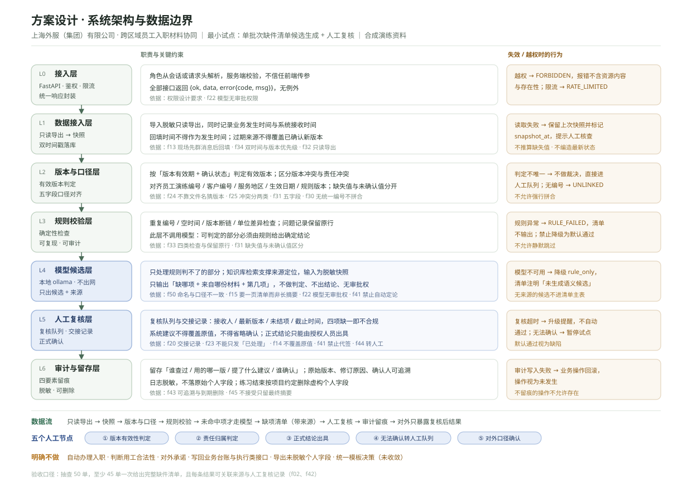

# 入职材料完整性核对系统 · 技术方案

| 项目 | 内容 |
|---|---|
| 客户 | 上海外服（集团）有限公司（人力资源服务） |
| 项目 | 跨区域员工入职材料协同 |
| 文档版本 | v1.0 · 方案设计阶段 |
| 适用范围 | 单批次入职服务单的缺件清单候选生成与人工复核 |
| 资料性质 | 合成演练资料。文中标注【演练假设】的数字不得作为对外报价或实际经营数据使用 |

---

## 一、对项目的五句话理解

1. 这套系统要解决的不是"把入职核对自动化"，而是让一线在处理入职服务单时不再反复催件、不再逐个确认对方手里是哪一版清单。
2. 它的唯一产出是一页缺项清单——缺哪一项、出自哪份材料、在第几项，而不是一份很长的泛化摘要。
3. 它读的是脱敏只读导出，不写回业务系统、不发外部消息、不调用执行类接口，模型本身没有任何审批权限。
4. 所有正式结论必须由授权人员确认，系统只提供材料与来源，无法确认时必须进人工队列，不允许默认通过。
5. 试点只用四周、两名业务骨干、每人每周四小时，验收只认一个口径：抽查 50 单至少 45 单一次给出完整缺件清单，且每条能关联来源与人工复核记录。

## 二、背景与问题

### 2.1 现状链路

客户提交 → 区域核对 → 补件 → 服务确认 → 归档，共六个节点。现场调研已还原出 8 条异常路径与 5 个人工判断点。

### 2.2 已确认的四个问题

| 问题 | 现场表现 | 事实编号 |
|---|---|---|
| 清单版本不一致 | 区域之间版本号不同，一线要逐个确认对方手里是哪一版，还要记清发生在哪个节点、影响哪些员工 | f10 |
| 交接记录不规范 | 交接常只留一句"已处理"，缺接收人、版本、未结项与截止时间 | f20、f23 |
| 时间基准失真 | 现场先用群消息处理、再补填表格，回填时间被当成了发生时间 | f13 |
| 未收敛的口径冲突 | 客户要求统一模板，区域坚持保留本地材料差异 | f50 |

### 2.3 数据现状

入职服务单还没有统一的关联编号，现有工具是内部服务台、业务台账与文件库三类（f30）。五类关键字段需要对齐：员工演练编号、客户编号、服务地区、生效日期、规则版本；缺失值与未确认值必须分开处理（f31）。当前唯一可引用的业务量是"每月 800 单、平均补件 2.4 次"，且该数据明确为虚构演练样本（f12）。

## 三、系统定位与边界

### 3.1 一句话定位

这是一套材料完整性提示助手，不是入职办理系统，也不是审批系统。

### 3.2 它做三件事

1. 读取脱敏只读导出，按"版本有效期 + 确认状态"判定有效版本，判不了的转人工复核（f24、f25）。
2. 输出一页缺项清单，标明缺哪一项、来自哪份材料、在第几项（f15）。
3. 为每条结论标注来源位置，并预留人工复核记录位（f42、f45）。

### 3.3 它明确不做

- 不自动办理入职、不判断用工合法性、不代替业务对外承诺（f05、f52）
- 不生成"系统自动定论"，不代签，不覆盖原值，不省略人工确认（f41、f14、f22）
- 不写回业务系统、不发外部消息、不调用执行类接口（f32）
- 不导出未脱敏个人字段；练习结束按项目约定删除虚构个人字段（f43）
- 不做统一模板的决策（f50 尚未收敛）

### 3.4 五个必须存在的人工节点

| 节点 | 系统提供什么 | 人必须做什么 |
|---|---|---|
| 版本有效性判定 | 有效期与确认状态候选 | 确认哪一版有效，判不了进队列（f24、f25） |
| 责任归属判定 | 未结项与交接记录清单 | 判定责任归属，系统不判责（f25） |
| 正式结论出具 | 候选缺项与来源 | 授权人员确认，禁止自动定论与代签（f41） |
| 无法确认转人工 | 待人工关联标记 | 进入人工队列，必要时暂停试点（f44） |
| 对外口径确认 | 只读结果视图 | 对外承诺由业务人员确认（f52） |

## 四、最小试点方案

### 4.1 试点选定

最小试点为单批次入职服务单的"缺件清单候选生成 + 人工复核确认"，只覆盖区域核对到补件之间的缺项识别环节。试点单元为一个批次，批次由业务负责人指定（f05）；周期四周；客户侧投入两名业务骨干，每人每周不超过四小时，合计 32 人时（f03）。

### 4.2 三种方案比较

| 维度 | 方案 A 人工优化 | 方案 B 确定性规则 | 方案 C 本地模型 + 知识库 |
|---|---|---|---|
| 具体做法 | 统一缺件清单模板，规范交接记录 | 按五字段口径与必填项比对，命中即输出缺项 | 脱敏快照 + 本地小模型抽取，检索知识库定位来源 |
| 能解决 | 交接信息缺失、记录不规范（f23） | 重复编号、空时间、版本断链、单位差异（f33）；五字段完整性（f31） | 材料命名与清单口径不一致（f50）；非结构化材料的语义匹配 |
| 解决不了 | 版本判定与跨区域口径差异 | 同一材料多种命名、多版本共存时无法判断该比哪一份（f24、f25） | 会误报漏报，且不能自证来源，不能给出正式结论 |
| 可解释性 | 高 | 高（规则可读） | 中（需强制输出来源位置） |
| 维护成本 | 低 | 中（区域差异需逐条枚举） | 中（知识库需随规则版本更新） |
| 四周能否上线 | 能 | 能 | 能（限单批次、单一区域口径） |
| 是否触碰红线 | 否 | 否 | 有风险，需人工复核兜底（f41、f44） |

**结论**：以方案 B 为主、方案 C 为辅。规则负责可判定部分并给出确定结论；模型只在规则判不了的地方生成候选缺项，且每条候选必须带来源位置，未定位到来源的一律不进清单主表。

### 4.3 为什么需要模型

1. 材料命名与区域清单口径不一致，客户要求统一模板而区域坚持保留本地差异（f50），这类差异无法用字段规则穷举，需要语义匹配，但只输出候选。
2. 同一材料多版本共存，有效性由"版本有效期 + 确认状态"判定（f24、f25）；规则负责判定有效性，模型负责定位正文位置，使每条结论都能挂上来源（f42）。
3. 一线明确要的是一页缺项清单加来源位置，不是长摘要（f15），这是抽取与定位任务，正是模型适合的部分。

**以下部分不需要模型，也不允许用模型**：五字段完整性校验与四类数据质量检查（f31、f33）属纯规则；责任归属判定（f25）与正式结论出具（f41）属纯人工。

### 4.4 试点排除范围

版本有效性与责任归属的自动判定；自动办理入职与用工合法性判断；对外通知与承诺；统一模板决策本身；工单量、工时、补件次数的自动统计；与业务台账的双向写入；跨区域推广与绩效挂钩。

## 五、系统架构

### 5.1 七层结构与失败行为

架构分七层，从上到下依次是接入层、数据接入层、版本与口径层、规则校验层、模型候选层、人工复核层、审计与留存层。每层的职责、关键约束与失败行为如下。

| 层级 | 职责 | 关键约束 | 失败行为 |
|---|---|---|---|
| L0 接入层 | 鉴权、限流、统一响应封装 | 角色服务端解析，不信任前端传参 | 越权返回 FORBIDDEN，不泄露资源存在性 |
| L1 数据接入层 | 导入只读导出、生成快照 | 同时记录业务发生时间与系统接收时间（f13、f34） | 保留上次快照并标记时间，提示人工核查（f35） |
| L2 版本与口径层 | 有效版本判定、五字段对齐 | 不靠文件名猜版本；无统一编号不拼合（f24、f30） | 判定不唯一不裁决，直接进人工队列（f25） |
| L3 规则校验层 | 重复编号、空时间、版本断链、单位差异 | 问题记录保留原行（f33） | 清单不输出，禁止降级为默认通过 |
| L4 模型候选层 | 生成缺项候选与来源定位 | 只抽取与定位，不做判定、无审批权（f22、f41） | 降级为规则单跑，标记未生成语义候选 |
| L5 人工复核层 | 复核队列、交接记录、正式确认 | 交接须列接收人、版本、未结项、截止时间（f20、f23） | 复核超时升级提醒，不自动通过 |
| L6 审计与留存层 | 四要素留痕、脱敏留存 | 能还原谁查过、用哪版、提什么建议、谁确认（f43、f45） | 审计写入失败则业务操作回滚 |

**一次完整请求的数据流**：只读导出 → 快照（双时间戳）→ 版本与口径判定 → 规则校验（保留原行）→ 仅未命中项走模型生成候选 → 合成缺项清单（每项带来源）→ 人工复核（四项交接信息）→ 审计留痕 → 对外只暴露复核后的结果。

### 5.2 技术选型

| 层次 | 选型 | 理由 |
|---|---|---|
| 服务框架 | FastAPI + Python 3.11+ | 类型校验与 OpenAPI 自动生成，接口契约可直接转成测试用例 |
| 模型推理 | 本地 ollama | 推理不出网，符合脱敏红线（f43） |
| 知识库 | 本地检索组件（Harness） | 支撑来源定位，不依赖外部服务 |
| 配置管理 | config.yaml | 密钥、模型地址不写死（代码规范） |
| 部署形态 | 单机本地部署 | 试点期不引入中间件，缩小运维面与故障面 |
| 数据存储 | 本地快照 + 只读导出 | 不建立业务主数据，不承担写回职责（f32） |

## 六、数据与权限矩阵

角色代号：L1 一线服务专员，L2 流程协调，L3 台账与集成，L4 质量与权限，L5 业务负责人，L6 客户协同。

| 数据对象 | L1 | L2 | L3 | L4 | L5 | L6 |
|---|---|---|---|---|---|---|
| D1 脱敏只读导出（原始） | 读 | 读 | 读 | 读 | 读 | 无 |
| D2 快照与版本判定结果 | 读 | 读 | 读写 | 读 | 读 | 无 |
| D3 缺项清单（候选） | 读 | 读 | 无 | 读 | 读 | 无 |
| D4 人工复核记录 | 读写 | 读写 | 无 | 读 | 读 | 无 |
| D5 规则版本与字段口径 | 无 | 读 | 读写 | 读 | 读 | 无 |
| D6 审计日志 | 无 | 无 | 读 | 读写 | 读 | 无 |
| D7 对外口径结果 | 读 | 读 | 无 | 读 | 读 | 只读 |

权限实现四条硬要求：角色服务端校验；越权返回 FORBIDDEN 且不透露资源存在性；任何写操作同步落审计，审计失败则写操作失败；模型层不持有任何数据写权限（f22）。

## 七、接口契约与异常处理

### 7.1 五个接口

| 接口 | 方法 | 作用 | 权限 |
|---|---|---|---|
| /api/v1/import | POST | 导入只读导出，生成快照 | L3 |
| /api/v1/checklist | POST | 生成缺项清单，返回候选与来源位置 | L1、L2、L5 |
| /api/v1/review | POST | 提交人工复核结论 | L1、L2 |
| /api/v1/audit | GET | 审计查询 | L4 |
| /api/v1/health | GET | 健康检查与模型可用状态 | 公开 |

统一响应结构：`{"ok": bool, "data": ..., "error": {"code": str, "msg": str}}`

错误码：FORBIDDEN、NOT_FOUND、INVALID_STATE、RULE_FAILED、MODEL_UNAVAILABLE、SNAPSHOT_STALE、UNLINKED_RECORD、RATE_LIMITED。

接口明确不提供：写回业务系统、发外部消息、执行类动作、批量导出个人字段（f32）。

### 7.2 失效与越权处理

| 场景 | 处理方式 | 依据 |
|---|---|---|
| 只读导出读取失败 | 保留上次快照并标记时间，提示数据可能过期，不推算不编造 | f35 |
| 模型服务不可用 | 降级为规则单跑，标记 RULE_ONLY，清单注明未生成语义候选 | 方案取舍 |
| 单据无统一关联编号 | 不强行拼合，标记 UNLINKED_RECORD 转人工关联 | f30 |
| 越权访问 | 返回 FORBIDDEN，不判断也不泄露资源存在性，同时记审计 | 权限要求 |
| 版本判定不唯一 | 不裁决，直接进人工复核队列 | f25、f44 |
| 审计写入失败 | 业务操作回滚，操作视为未发生 | f43 |

## 八、报价与投入产出测算

### 8.1 计算器六项取值

| 输入项 | 取值 | 口径与来源 |
|---|---|---|
| 一次性实施报价 | 88000 元 | 含开发、集成、部署、培训与四周试点支持【演练假设】 |
| 每月运行费用 | 2400 元 | 服务器折旧与电费 1200 + 模型与知识库维护 800 + 运维支持 400【演练假设】 |
| 每月处理数量 | 800 件 | 取自 f12，明确为虚构演练样本，不代表真实经营数据 |
| 节省单件时间 | 20 分钟 | 现状单均核对工时，含催件、版本确认、回填确认【演练假设】 |
| 人员综合时薪 | 120 元/小时 | 一线与服务协同岗综合人工成本【演练假设】 |
| 预计节省比例 | 45% | 剩余 55% 必须保留人工复核（f42）【演练假设】 |

口径说明：节省单件时间填现状单均工时，乘节省比例后才是实际可省部分，避免重复计算，即每单实际节省 9 分钟。

### 8.2 测算结果

| 指标 | 数值 |
|---|---|
| 每单实际节省 | 9 分钟 |
| 每月节省工时 | 120 小时 |
| 每月节省金额 | 14400 元 |
| 每月净收益 | 12000 元 |
| 首年累计节省 | 172800 元 |
| 首年总成本 | 116800 元 |
| 首年净收益 | 56000 元 |
| 首年 ROI | 47.9% |
| 回本周期 | 7.3 个月（第 8 个月转正） |

### 8.3 两个必须分开说的口径

推广口径（每月 800 单）首年净收益 56000 元、ROI 47.9%、回本 7.3 个月，但依赖三个未验证假设，不能作为对外承诺。试点口径（单批次，假设每月 200 单）每月节省 3600 元、净收益 1200 元、回本需 73 个月——试点本身不回本，其价值是验证 50/45 验收口径并采集真实基线。

### 8.4 敏感性分析

| 变动项 | 月净收益 | 回本周期 |
|---|---|---|
| 基准（800 单 / 45% / 120 元） | 12000 元 | 7.3 个月 |
| 节省比例降至 30% | 7200 元 | 12.2 个月 |
| 时薪降至 80 元 | 7200 元 | 12.2 个月 |
| 单量降至 400 单 | 4800 元 | 18.3 个月 |
| 节省比例 30% 且时薪 80 元 | 4000 元 | 22.0 个月 |

回本周期对"节省比例"和"时薪"最敏感，而这两项恰恰最缺证据。因此试点应优先采集驳回率与薪酬口径，而不是优先统计单量。

### 8.5 商务条件

报价为含税价，增值税按 6% 计列。付款节点：合同签订 30%、试点验收通过 40%、稳定运行 30 天后 30%。变更条件：试点范围超出单批次、新增区域或业务线、新增写回或执行类接口、单月处理量超过测算值 50%、要求提供非脱敏数据，任一发生需重新报价。不含项：客户侧人员工时、硬件采购、网络与安全合规改造、与业务台账的写回集成。

## 九、实施计划

受"四周、两名骨干、每周不超过四小时"约束（f03），客户侧合计 32 人时，超出须重新评估。

| 阶段 | 交付物 | 客户投入 | 验收标志 |
|---|---|---|---|
| 第 1 周 口径对齐 | 五字段口径确认单、字段映射表、快照导入跑通 | 流程协调 4h、台账与集成 4h | 能用真实格式导出生成可核对快照 |
| 第 2 周 规则先行 | 四类规则检查、版本判定、缺项清单 v0 | 流程协调 4h、一线 4h | 清单能一次给出缺项，允许只覆盖规则可判定部分 |
| 第 3 周 模型与复核闭环 | 候选生成、复核队列、交接记录、审计留痕 | 一线 4h、质量与权限 4h | 任取一单可还原"谁查过、哪版、什么建议、谁确认" |
| 第 4 周 50 单验收 | 抽查结果、驳回率统计、错误复盘、评估报告 | 业务负责人 4h、质量与权限 4h | 给出 45/50 是否达成的结论与采纳、扩大、停止建议 |

## 十、验收标准与停止条件

### 10.1 验收（三条同时满足）

1. 抽查 50 单中至少 45 单一次给出完整缺件清单（f02、f42）
2. 每条结果可关联来源位置与人工复核记录，缺一不可（f42）
3. 人工复核驳回率可接受，演练假设不超过 20%，需在试点首周确定基线

### 10.2 停止条件（任一触发即暂停，f04）

连续两个批次驳回率高于 20%；出现任何"系统自动定论"或一线代签记录（f41）；质量与权限负责人行使否决权（f04）；无法确认版本或关键字段的处理被默认通过（f44）。

## 十一、风险与待验证项

| 风险 / 缺口 | 影响 | 处理方式 | 责任人（待确认） |
|---|---|---|---|
| 真实单量、单均工时未采集 | ROI 测算全部依赖假设 | 试点首周取原始业务发生时间，不用回填时间 | 流程协调 |
| 节省比例 45% 未验证 | 回本周期可能在 7 至 22 个月之间 | 以 50 单驳回率校准 | 一线服务专员 |
| 时薪 120 元未取薪酬口径 | ROI 对时薪高度敏感 | 由客户财务口径确认 | 业务负责人 |
| 统一模板未收敛（f50） | 跨区域比对口径不一致 | 不纳入试点，列为待确认事项 | 客户协同与流程协调 |
| 驳回率阈值 20% 为假设 | 停止条件生效点不确定 | 首周确定基线后写死 | 质量与权限 |
| 模型误报漏报 | 增加人工复核负担 | 只出候选、必须带来源、无来源不进主表 | 实施方 |

## 十二、附录 · 事实索引

本方案引用编号与项目台账一致，共涉及 36 条访谈事实中的 27 条。核心引用：定位与边界 f00、f05、f52；验收 f02、f42；预算与决策 f03、f04；版本与口径 f24、f25、f31、f33；现场约束 f13、f20、f23；系统与数据 f30、f32、f34、f35；权限与审计 f22、f41、f43、f44、f45；冲突与指标 f12、f15、f50、f51。

方案设计阶段闸门：试点边界、方案取舍、数据权限与实施计划已评审。
