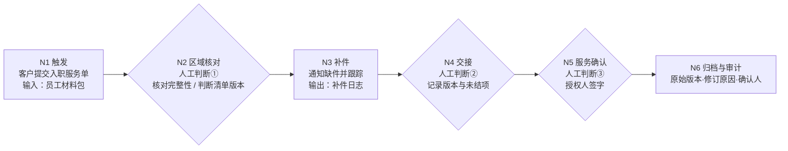
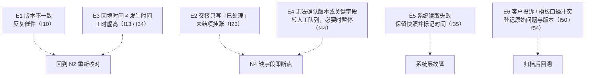

# 现状流程图 · 跨区域员工入职材料协同

> 可编辑源文件（Mermaid）。渲染版本见同目录《现状流程图.svg》。
> 事实编号 fXX 对应《访谈记录.md》；本图为合成演练，数据不代表企业真实情况。

## 一、正常路径

## 二、异常路径（回指主流程）

## 三、瓶颈与责任人

| 编号 | 瓶颈 | 责任人 | 依据 |
|---|---|---|---|
| B1 | 版本判定与责任归属 | 林亦舟 · 一线服务专员 | f11 |
| B2 | 交接记录完整性 | 唐映秋 · 项目流程协调员 | f23 |
| B3 | 工时口径（回填 vs 发生） | 林亦舟 + 秦芮 | f13、f34 |
| B4 | 缺件清单可读性 | 林亦舟（需要一页清单 + 来源位置） | f15 |
| B5 | 无统一关联编号 | 秦芮 · 数字化工程师 | f30 |
| B6 | 复核留痕缺失被退回 | 傅景 · 审核与质量负责人 | f42、f45 |

## 四、只能由人完成的判断

1. **清单版本是否有效** —— 规则判不了时需人工裁定（f24、f25）
2. **责任归属判定** —— 交接断点需人证（f11）
3. **正式结论确认** —— 授权人签字，模型无审批权（f22、f41）
4. **兜底转人工 / 暂停** —— 风险不可控时由审核方叫停（f44）
5. **对外承诺** —— 客户侧口径由业务人员确认（f52）

## 五、绘制说明

- 实线 = 正常路径；虚线 = 异常或返工分支
- 菱形 = 人工判断点（N2、N4、N5）
- 支撑系统：内部服务台 · 业务台账 · 文件库（无统一关联编号，f30）
- 现场并行做法：企业群消息先行处理、事后回填表格（f13）——系统记录滞后于真实事件
